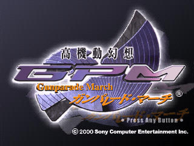
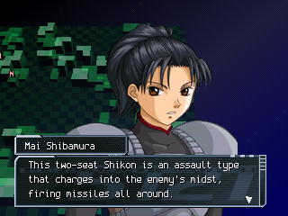
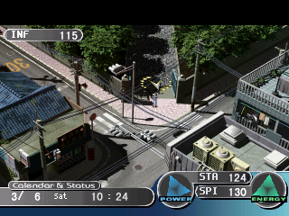
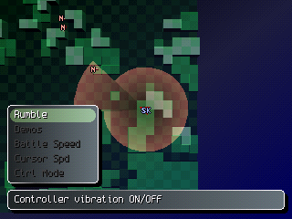
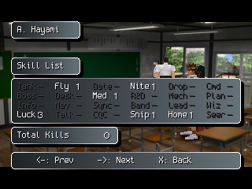

# Koukidou Gensou: Gunparade March — English Patch (MTL)

An English fan translation patch for **Koukidou Gensou: Gunparade March** (高機動幻想ガンパレード・マーチ), the 2000 PlayStation game by Alfa System / Sony Computer Entertainment (Japan, SCPS-10136).

**Latest release: [v1.0](../../releases/latest) (final)**

 
 


## About this translation

This is an **independent, machine-assisted (MTL) translation**, made from scratch from the original Japanese disc. It uses its own translation scripts and custom tools to handle the event archive, the program overlays and the font. It is not based on any other translation.

It is **not related to Asterhex's human translation** of Gunparade March, which is a separate project. For human-quality English, that translation is the better choice:
➡️ https://github.com/phukyes/Gunparade-March-English

Because this is a machine-assisted translation, expect some awkward phrasing and the occasional mistranslation. Bug reports are welcome.

## What's translated

- All story events and conversations (1,183 event scripts)
- Menus, status screens, the bulletin board, skills and messages
- Battle screens, the tutorial and battle menus
- Map and location names
- In-game graphics and labels
- A new English font with letter pairs, so more text fits in each box

Some long names and labels are shortened to fit the game's fixed-size boxes (for example "H. Yoshino" on the bulletin board, and 4-letter skill names on the Skill List). A few hidden developer/debug screens are still in Japanese.

## How to apply

You need your own disc image of the Japanese release, as a single `.bin` + `.cue`. **No game data is included or distributed here.**

| | |
|---|---|
| File | `Koukidou Gensou - Gunparade March (Japan).bin` |
| Size | 440,372,016 bytes |
| MD5 | `66709F78ABFDC5A4CC40A8A47C274441` |
| SHA-1 | `1FD53D0FCDC2D9C8FA61E5640206B78A5E0ED0ED` |

This matches the Redump dump. If your image doesn't match, the patch won't apply.

1. Download the release zip from the [Releases](../../releases) page.
2. Apply the `.xdelta` patch to your `.bin` with any xdelta patcher:
   - In a browser: [ROM Patcher JS](https://www.marcrobledo.com/RomPatcher.js/)
   - Windows: Delta Patcher or xdelta UI
   - Command line:
     ```
     xdelta3 -d -s "Koukidou Gensou - Gunparade March (Japan).bin" "Gunparade March (English v1.0).xdelta" "Gunparade March (English v1.0).bin"
     ```
3. Keep the patched `.bin` next to the included `.cue`, and load the `.cue` in your emulator.

## Compatibility

- Tested in PCSX-ReARMed. It should work in DuckStation and other accurate emulators.
- Memory card saves work normally. Emulator save states from a different patch version won't.
- **SwanStation (including PS5):** if you see noise or garbage in the right half of dialogue boxes, turn on anti-aliasing (MSAA) or set the GPU renderer to Software in Core Options. This is an emulator rendering quirk, not a problem with the patch.

## Testing

Each release is checked by:
- loading every one of the 1,183 event scripts in an emulator and comparing the result against the original Japanese disc;
- long automated play sessions (menus, school days, battles, dialogue) that watch for freezes.

Found a freeze, a crash or untranslated text? Please [open an issue](../../issues) with the in-game date, where you were and a screenshot if you can.

## Changelog

**v1.0 (final)**
- Full review of the whole script: every event and all menu, battle, conversation and proposal text re-checked against the Japanese. About 470 lines fixed (meaning errors, wrong speakers, flipped negations, typos, stiff phrasing).
- Names and terms made consistent between events and menus (Shikon tuning stats, "Leap", "Barrage", "Class Rep", the Gunparade March song refrain, Akira's name in item names).
- Fixed line breaks in the Shikon Unit selection and work results menus.

**v0.9.1**
- Maintenance screen: removed a stray text code in front of "SMG" in the weapon list.
- Maintenance screen: the 40mm anti-aircraft gun was mislabeled "20mm".
- Checked every translated file against the memory it loads into; all fit.

**v0.9**
- Shortened two NPC chatter files to fit the game's memory limit, with a build check for all chatter files.

**v0.8**
- Fixed two story events that could freeze the game.
- Bulletin board name boxes now show readable short names instead of cut-off fragments.
- The Skill List grid now lines up, using 4-letter skill names.
- Translated some debug menus that were still in Japanese.

**v0.7**
- First public release.

## Translation source

The full translation source (every Japanese line next to its English) is in `gpm_translation_source.zip` in this repo.

## Legal

This is an unofficial fan project, not affiliated with or endorsed by Sony Interactive Entertainment or Alfa System. Gunparade March and all related names belong to their respective owners. Only patch files are distributed; please don't ask for, or share, disc images.
